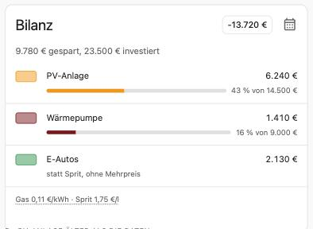

# Energy Payback

A Home Assistant integration with its own dashboard card. It shows what your
PV plant, heat pump, and electric car have saved compared with what they
replaced, and whether and when they pay off.

Home Assistant's energy dashboard shows what you consumed, produced, and paid.
Energy Payback answers the questions that come next:

- What has each investment saved so far?
- Has it paid for itself yet? If not, roughly when?
- Is the whole electrification in the plus already?

It needs no YAML, no helpers, and no template sensors. Everything it can, it
takes from the energy dashboard; it asks only for what Home Assistant cannot
know, such as what the heat pump cost extra or what gas cost on average.



## Use cases

- See at a glance whether the PV plant, heat pump, and electric car together
  have already saved more than they cost.
- Get a notification when the heat pump has paid for itself.
- Compare the yearly saving of each investment, for example before deciding on
  a battery or a second wallbox.
- Keep an honest record: savings can be negative for a while, for example when
  electricity is expensive and gas is cheap, and the integration shows that.

## What it calculates

There are three categories. Each compares reality with the alternative it
replaced.

| Category | Saving | Compared with |
|---|---|---|
| PV plant | Solar power used in the house, valued at the electricity price of that hour, plus the feed-in compensation received. A home battery counts as part of the PV plant. | No PV plant: all electricity from the grid, no feed-in. |
| Heat pump | What the former gas or oil heating would have cost for the same heat, minus what the heat pump's electricity cost. | A gas or oil heating with 92 % efficiency; heating oil has 10 kWh per litre. Heat comes from heat meters where they measured, otherwise from electricity × seasonal COP. |
| Electric car | What fuel would have cost for the same distance, minus what the charging electricity cost. | A combustion car. The distance follows from the energy charged at the wallbox and the electric car's consumption. |

- **No double counting.** The three savings add up to the household's total
  saving. The benefit of solar power belongs to the PV plant alone; heat pump
  and electric car pay for all their electricity at the price of that hour,
  even when the sun delivered it.
- **Prices at the time of use.** The electricity price of each hour is what the
  energy dashboard charged for it, so dynamic tariffs are handled hour by
  hour. With several tariffs, such as day and night, the average of the hour
  counts. Heat pump and electric car can have an own tariff instead.
- **Measurements are facts.** Energy Payback never filters or corrects
  readings. If a meter recorded a wrong value, fix it in Home Assistant's
  statistics tools, which also fixes the energy dashboard, then choose
  *Recompute* (see below).
- **Honest numbers.** There is no yearly average before twelve months of data,
  because seasons would distort it. Heat that was estimated instead of
  measured is marked as such.

### Three phases

Each category counts from the first hour Home Assistant has data for it.

| Phase | What counts |
|---|---|
| Before Home Assistant had data | Nothing. There is no starting value and no import. The card says since when it counts. |
| From the first data to the setup | One average per value (gas, oil, or fuel price, consumptions, seasonal COP, own tariff), entered at setup, because Home Assistant does not know earlier prices. |
| From the setup on | The averages as starting values. Changed values and a price sensor apply from the next full hour; what was computed stays, just as the energy dashboard treats a new electricity price. |

## Supported setups

Energy Payback works with any energy dashboard that has:

- a grid import with an electricity price (a fixed price, a price entity, or a
  cost statistic), and
- for the **PV plant**: at least one solar production source. Several solar
  sources and home batteries are counted together as one PV plant. Without a
  feed-in meter all solar power counts as used in the house; the setup warns
  about it.
- for the **heat pump** and the **electric car**: their electricity meters
  under *Individual devices*. Choose a total meter, or the parts that add up to
  it, for example heating and hot water, or two charging points. Meters the
  energy dashboard marks as included in another selected meter are not
  counted twice. A meter belongs to one category only.

Not supported: other alternatives than a gas or oil heating and a combustion
car, gas prices per cubic metre, solar thermal, investments from a helper,
and fetching prices from online services. Price sensors you already have can
be used, though.

Home Assistant 2026.10 or newer is required.

## Installation

1. Set up the [energy dashboard](https://my.home-assistant.io/redirect/config_energy/)
   with grid import and electricity price, your solar production, and the
   meters of heat pump and wallbox under *Individual devices*.
2. Install Energy Payback from the Marketplace (Settings › Marketplace) or HACS
   as a custom repository: `https://github.com/ignazhabibi/ha-energy-payback`,
   type *Integration*.
3. Restart Home Assistant.
4. Go to **Settings › Devices & services › Add integration** and choose
   **Energy Payback**.
5. Follow the setup (see below), then assign areas to the new devices if you
   like.
6. Add the card **Energy Payback** to a dashboard from the card picker, and
   **Energy Payback history** if you like. They have no options. There is no
   dashboard resource to add: the integration serves the cards itself and
   updates them with the integration.

The past is computed in the background right after setup. This usually takes
less than a minute; until then the card says that it is calculating.

## Configuration

### Setup

1. **Overview**: what the energy dashboard provides, and what to evaluate.
   Nothing is preselected; only possible categories are offered.
2. **PV plant**: since when it counts, and the purchase cost (optional).
3. **Heat pump**:
   | Field | Description |
   |---|---|
   | Electricity consumption | The heat pump's meters from the energy dashboard's individual devices. |
   | Produced heat (optional) | Heat meters for the same parts as the electricity meters. An hour counts as measured when every heat meter has data for it. |
   | Former heating | Gas or oil. |
   | Extra cost (optional) | Extra purchase cost over a gas or oil heating, for the payback. |
4. **Heat pump, average since the first data**:
   | Field | Description |
   |---|---|
   | Gas price or heating oil price | Average per kWh (gas) or per litre (oil). Also the current value from now on. |
   | Seasonal COP | Only asked without heat meters, or when the heat data begins later than the electricity data; the step names until when it estimates. Later gaps use the COP measured until then. |
   | Own electricity tariff (optional) | Only with a separate heat pump tariff. |
   | Gas or oil price sensor (optional) | Replaces the average from the setup on. While it has no value, its last value counts. |
5. **Electric car**: charging meters, and the extra purchase cost over a
   combustion car (optional).
6. **Electric car, average since the first data**: consumption of the electric
   car (measured at the wallbox, with charging losses; with several cars,
   their average), consumption of a comparable combustion car, fuel price, an
   own tariff (optional), and a fuel price sensor (optional).

### Changing things later

Categories are config subentries. On the integration page each category has
**Reconfigure** and **Delete**, and there are buttons to add the categories not
set up yet; they lead through the same steps as the setup.

**Reconfigure** opens a menu:

| Option | What it does |
|---|---|
| Values from now on | New prices, consumptions, COP, tariff, or price sensor. They apply from the next full hour. |
| Averages before the setup | Corrects the averages of the time before the setup. That time is computed again. |
| Meters and extra cost | Other meters or another former heating compute everything again; another former heating asks for its prices. The extra cost applies at once. |
| Recompute | Computes the category again with the current data, for example after you fixed a wrong reading in the statistics. All values stay. |
| Purchase cost (PV plant) | Applies at once. |

Changes in the energy dashboard are followed automatically and compute the
affected category again.

## Entities

Each category is a device with three sensors; one more device holds the
overall balance.

| Entity | Description |
|---|---|
| Saving | Total saving since counting began, in your currency. It has long-term statistics, including the computed past. Its attributes show since when it counts, the investment, from when yearly figures exist, the gas, oil, or fuel price in effect now, and for the heat pump the former heating and whether heat was partly estimated. |
| Paid back | Share of the investment the saving has covered, in percent. Unknown without an investment. |
| Saving per year | Average saving per year. Unknown before twelve months of data. |
| Balance | All savings minus all investments. Unknown while any category is calculating or has no data yet. |

## The cards

### Energy Payback

The card finds the categories by itself. The button in its header switches
between two views:

- **Total**: savings so far against the investments, with the progress of each.
- **Per year**: yearly averages, the years still to go, and roughly when the
  household will be in the plus.

Each row says since when it counts. The gas, oil, and fuel prices in use are
shown at the bottom; selecting them opens the integration page, where they are
changed. The card follows light and dark themes, works on phones and desktops,
and can be used with keyboard and screen reader.

### Energy Payback history

What each category saved per hour, day, month, or year, as stacked bars in
the look of the energy dashboard. A month in which a category cost more than
it saved shows below the line. The card reads the long-term statistics of the
saving sensors, which include the computed past.

With an *Energy date selection* card on the same dashboard, it follows the
selected period: hours for a day, days for a week or month, months for a year.
Without one it shows one bar per year since counting began.

## How the data updates

Energy Payback reads the recorder's hourly long-term statistics of the meters
in the energy dashboard. It checks for newly compiled hours every 15 minutes,
and at once when the energy dashboard changes. Each hour is valued with the
prices of that hour. When Home Assistant was off, the recorder reports the
missed energy with the next hour, so no energy is lost; prices of the missing
hours are not known and the next hour's price is used.

## Example automation

Notify when the heat pump has paid for itself:

```yaml
triggers:
  - trigger: numeric_state
    entity_id: sensor.heat_pump_paid_back
    above: 100
actions:
  - action: notify.notify
    data:
      message: "The heat pump has paid for itself."
```

## Known limitations

- The time before the setup is computed with one average per value, because
  Home Assistant does not know earlier gas, oil, or fuel prices. A price
  sensor's history from before the setup is not used.
- Only data Home Assistant has counts. Savings from before Home Assistant
  recorded the energy dashboard cannot be imported.
- Several cars sharing a wallbox use one average consumption.
- The yearly average is a plain average since counting began; the first and
  last partial seasons can make it a little high or low.
- The energy dashboard and the recorder statistics have no public Python
  interface. Energy Payback keeps all access to them in one module and raises a
  repair issue instead of showing wrong numbers if a Home Assistant update
  changes them.

## Troubleshooting

- **Setup ends right away**: the energy dashboard has no grid import with an
  electricity price, or neither solar production nor individual devices. The
  message names what is missing and links to the energy dashboard.
- **Heat pump or electric car are not offered**: their meters must be listed
  under *Individual devices* in the energy dashboard.
- **A figure jumps implausibly**: a meter probably recorded a wrong reading.
  Fix it under **Developer tools › Statistics**, then choose *Reconfigure ›
  Recompute* for the category.
- **A repair issue says a meter or price sensor is missing**: it was removed.
  The category keeps its last figures, or the sensor's last price. Add it back,
  or choose another one with *Reconfigure*.
- **No payback percentage**: enter the purchase or extra cost.
- **The card says it is calculating for long**: download the diagnostics from
  the integration page and open an issue with them.

## Removal

1. Remove the cards from your dashboards.
2. Go to **Settings › Devices & services › Energy Payback**, open the menu
   (⋮) and choose **Delete**. To remove one category only, use **Delete** in
   that category's menu.
3. Uninstall Energy Payback in the Marketplace or HACS and restart Home
   Assistant.

The long-term statistics of the saving sensors stay in the recorder until you
remove them under **Developer tools › Statistics**.

## Development

- Python: `uv sync --group dev`, then `uv run pytest`, `uv run mypy`, and
  `uv run ruff check`.
- Translations are generated: edit `scripts/translations.py` and run it.
- Card: in `card/`, `npm ci` and `npm run build`. The built file is committed,
  because the Marketplace installs exactly what is published.
  `card/demo/index.html` shows the card's states with a mocked Home Assistant.

## License

MIT
